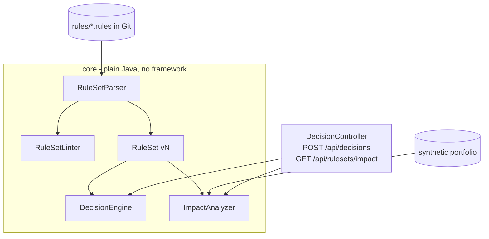

# credit-decision-rules-engine

A Java 21 / Spring Boot 3 service that makes **APPROVE / REFER / DECLINE** decisions from versioned, plain-text credit rules, and shows exactly which applications a proposed rule change would affect before it ships.

> **Portfolio project.** Written independently to demonstrate rules-engine and decisioning patterns. All rules, thresholds and applicant data are synthetic and illustrative. It is not based on any lender's actual strategy, and nothing here is credit, legal or compliance advice.

## Business problem

In lending, rule changes are high risk. Moving a score cutoff or DTI limit by a few points can change thousands of decisions, and regulators expect every adverse decision to have a clear reason. Commercial engines (IBM ODM, Drools, FICO Blaze) handle authoring and execution. The engineering work around them is what this project focuses on: keeping rules in version control, rejecting unsafe edits automatically, and measuring the impact of a change on a known portfolio.

## Features

- **Readable rule files** (`src/main/resources/rules/*.rules`) that reviewers can diff in a pull request:
  ```
  version: 2026.1
  D01 | DECLINE | creditScore < 580                         | Credit score below program minimum
  R01 | REFER   | debtToIncome > 0.43 and creditScore < 700 | Elevated debt-to-income with near-prime score
  ```
- **Deterministic engine:** all rules are evaluated, the most severe outcome wins, and only the reasons for that outcome are returned (the basis of an adverse-action notice).
- **Governance linter** runs at load time: unknown facts, rules on protected attributes or obvious proxies (age, sex, race, marital status, ZIP code…), missing reason text, duplicate codes and explicit APPROVE rules all fail. The application refuses to start with an invalid rule set.
- **Impact analysis:** `GET /api/rulesets/impact?candidate=2026.2` replays a 250-application synthetic portfolio through the active and candidate rule sets and returns outcome counts, a transition matrix (`APPROVE->DECLINE`, etc.) and every changed application with its new reason codes.
- **Golden-file regression test:** every decision on the synthetic portfolio is pinned in `expected-decisions-v1.csv`. A rule edit that changes any outcome fails CI until the golden file is updated on purpose in the same PR.

## Architecture



## Tech stack

Java 21 (records, sealed types, switch expressions) · Spring Boot 3.3 · Bean Validation · JUnit 5 · Docker · GitHub Actions

## Run locally

```bash
mvn spring-boot:run

curl -X POST localhost:8082/api/decisions -H 'Content-Type: application/json' -d '{
  "applicantId":"demo-1","creditScore":690,"annualIncomeMinor":6000000,"monthlyDebtMinor":230000,
  "requestedAmountMinor":1200000,"employmentMonths":36,"openDelinquencies":0,"bankruptcyLast7Years":false}'
# => REFER with reason R01

curl 'localhost:8082/api/rulesets/impact?candidate=2026.2'
```

On the bundled synthetic portfolio, moving from 2026.1 to 2026.2 changes 35 of 250 decisions (7 APPROVE→DECLINE, 15 APPROVE→REFER, 4 DECLINE→APPROVE, 7 DECLINE→REFER, 2 REFER→DECLINE). That is the kind of summary a credit-risk reviewer would sign off on.

Regenerate the portfolio with `java tools/GeneratePortfolio.java 250 > src/main/resources/portfolio/synthetic-portfolio.csv` (then update the golden file deliberately).

## Tests

```bash
mvn verify
```

13 tests cover parsing errors with line numbers, the governance linter, outcome precedence, compound conditions, zero-income handling, impact transitions and the golden regression set.

## Limitations and next steps

- Conditions support AND only; OR groups and computed facts would be the next additions.
- Rule sets load from the classpath. A real deployment would load them from a reviewed artifact store with approval metadata.
- Add champion/challenger routing to run a candidate rule set on a share of live traffic.

## License

MIT
